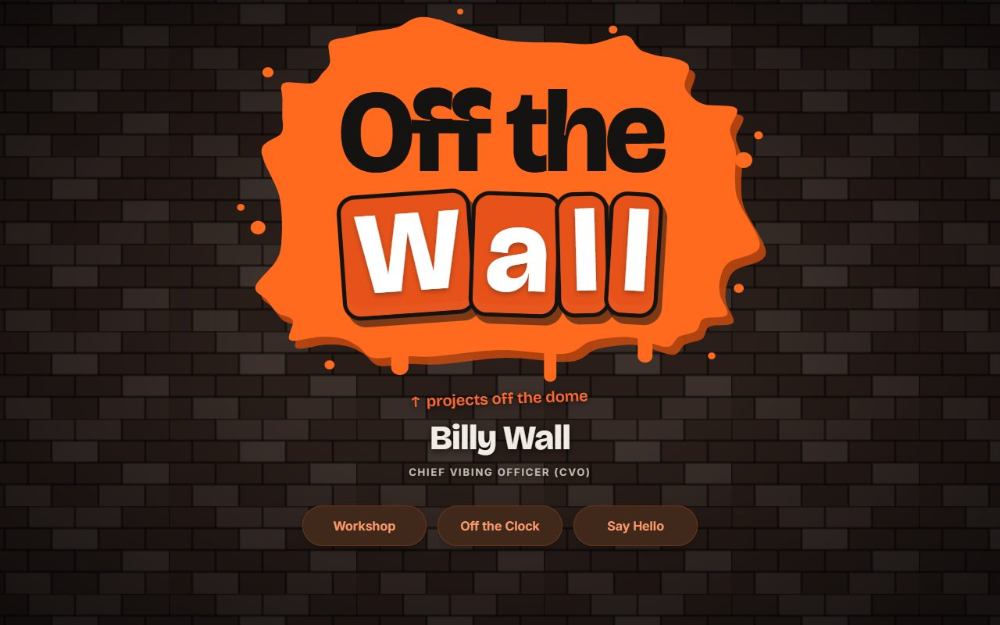
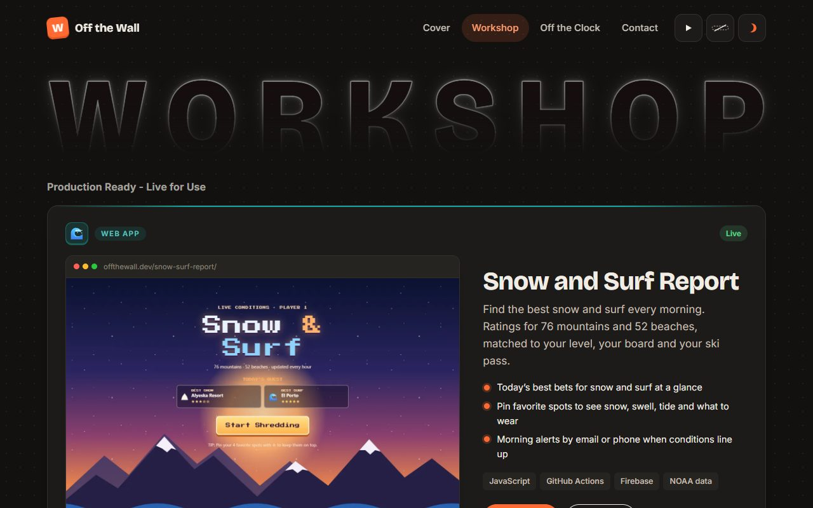

# Off the Wall

[](https://offthewall.dev/)

Billy Wall's personal site and project wall: **https://offthewall.dev/** (the old https://billywall732.github.io/ addresses redirect there).

Plain HTML, CSS and JavaScript. No build step for the site itself; one small Node script makes the project pages.

## Pages

| Page | Address | What's there |
|---|---|---|
| Cover | `/` | The brick wall, and three ways in: Workshop, Off the Clock, Say Hello |
| Workshop | `/home/` | Production Ready projects, then boxes that open the projects still on the Workbench (`#workbench`) and the Toolkit (`#toolkit`) |
| Off the Clock | `/home/#off-the-clock` | About me, How it got here, and Hobbies & Interests (`#hobbies`) |
| Contact | `/contact/` | Email, GitHub and LinkedIn |
| Projects | `/projects/<slug>/` | One page per project |



## How it fits together

This repo is named `billywall732.github.io`, which makes it the main GitHub Pages site for the account. Every other repo with GitHub Pages turned on shows up under it automatically:

| Address | Repo |
|---|---|
| `/` | this repo |
| `/projects/<slug>/` | this repo: one page per project |
| `/contrail/`, `/contrail/analytics/` | this repo: the Contrail app |
| `/wallet/` | this repo: the What's in My Wallet? app |
| `/code-breaker/` | this repo: Krillion Code Breaker (Workshop) |
| `/loop-lab/` | this repo: Loop Lab (Workshop) |
| `/snow-surf-report/` | snow-surf-report |
| `/fantasy-football/` | fantasy-football (built and pushed by the league's own repo) |
| `/my-budget-ledger/` | my-budget-ledger |

When a custom domain is added to **this** repo (Settings → Pages → Custom domain), all of them move with it: `yourdomain.com/snow-surf-report/` and so on.

## Add or change a project

Everything shown comes from **`js/projects.js`**: the home page tabs, each project's page, the Toolkit lists, the hobbies and the contact links.

1. Turn on GitHub Pages in the new project's repo (it then lives at `/<repo-name>/`).
2. Add a screenshot to `img/` (1280 × 800 works best, `.webp` or `.png`).
3. Copy an entry in `js/projects.js` and change it. `status` picks where it shows: `'live'` gets a big card under Production Ready - Live for Use; `'rough'` and `'workshop'` go in the Projects Still on the Workbench list (rough ones first).
4. Run `node tools/make-pages.mjs` to (re)make the pages in `projects/` and the feed at `/feed.xml`.
5. Commit and push. The site updates within a minute.

Step 4 is only needed when you add or remove a project, change a slug, name or tagline, or change a project's `updated` date. Other edits show up without it.

**Feed:** `/feed.xml` is an Atom feed with one entry per project, made by `tools/make-feed.mjs` (step 4 runs it). Feed readers show an entry again when its `updated` date in `js/projects.js` changes, so bump that date when a project changes in a way worth telling people. Every page links to the feed with `<link rel="alternate" type="application/atom+xml" href="/feed.xml">`; add that line to any new page.

## Files

```
index.html            the cover at / (brick wall, paint splat, three buttons: Workshop, Off the Clock, Say Hello); it never moves on by itself
home/index.html       the home page at /home/ (its header and footer are copied into the project pages)
projects/<slug>/      project pages, made by tools/make-pages.mjs; don't edit by hand
css/site.css          styles: dark, light and blueprint modes via CSS variables
css/cover.css         the cover's styles, including the brick texture (a tiny SVG tile per mode)
js/cover.js           the cover's opening, the bricks that answer a mouse, and the paint wipe into /home/ and /contact/
js/projects.js        the data: edit this to change what's shown
js/ui.js              shared: the top bar's toggles (background, board cursor, color mode), the phone menu, the dot background, card bits
js/slide.js, css/slide.css   the sideways slide between Workshop, Off the Clock and Contact
js/main.js            the home page: Workshop (one page; #workbench opens the projects still being built) and Off the Clock (one page; #hobbies goes to Hobbies & Interests)
contact/              the Contact page: three big buttons (email, GitHub, LinkedIn)
docs/                 screenshots for this README
js/project-page.js    a project's page
tools/make-pages.mjs  writes projects/<slug>/index.html for each project, then runs make-feed.mjs
tools/make-feed.mjs   writes feed.xml (Atom) from js/projects.js; don't edit feed.xml by hand
img/                  project screenshots; img/clock/ has the Off the Clock photos
photos/               your original photos (not committed: big, with location data)
icon.svg              the tab icon (img/icon-home.svg makes the home-screen icons; see Icons)
contrail/             Contrail, the flight and hotel log (app.js, csv.js import, demo-data.js, analytics/, cover/)
wallet/               What's in My Wallet?, the card tracker (app.js, demo-data.js, cover/)
code-breaker/         Krillion Code Breaker, a practice companion for krillion.io (app.js, prompts.js)
loop-lab/             Loop Lab, a 16-step loop maker with Web Audio sounds (no visit counter)
contrail/about/, wallet/about/   redirect to the apps' project pages
shared/               what both apps use:
  config.js           every environment value (Firebase, Worker, OAuth client, contact email) in one place
  store.js            the data layer; Phase 1 keeps everything in memory (a reload starts over)
  trips.js, travel.js trip math (time zones, miles) and the travel summary Wallet reads
  app-shell.js        site header/footer behavior, demo banner, file downloads
  data/               airports.json (from OurAirports), lounges.json, cards.json
tools/build-airports.mjs  rebuilds shared/data/airports.json (see the file for how)
reference/            the original claude.ai apps; not committed (Contrail's has real trips)
```

The **home page** has two sections. **Workshop** is one page under a big outlined WORKSHOP title, showing the Production Ready - Live for Use projects, then an orange dotted box, Projects Still on the Workbench, that opens the rest (`/home/#workbench`; old `#rough` and `#workshop` links open it too), and a teal dotted Toolkit box (`/home/#toolkit`). **Off the Clock** is one page under a big outlined OFF THE CLOCK title: three photos, a short bio and two counts (live projects and projects on the workbench) beside How it got here, then Hobbies & Interests (`/home/#hobbies`). `/home/#off-the-clock`, `#about` and the old `#story` open it, and old `/home/#work` links open Workshop.

The **top bar** (copied into every page by `tools/make-pages.mjs`) is Cover, Workshop, Off the Clock, Contact and three icon-only toggles: pause the background, the board cursor and color mode. On phones it folds into a menu button. Moving between Workshop, Off the Clock and Contact slides the page sideways (instant with reduced motion).

The **cover** plays a short opening once per visit (under a second; any key or tap ends it). Its three buttons roll a paint wipe into the next page, which rolls off on arrival. With reduced motion, from a deep link or on back/forward there's no animation at all, and every link works without JavaScript.

**Toolkit** lists the tools each app is built with (`toolkit` in `js/projects.js`). Only list a tool you can point to in that app's code; the file says where each one was checked.

Hobbies & Interests (Off the Clock) shows the activity blocks next to a photo slideshow (`clockPhotos` in `js/projects.js`). Tapping a block shows its photo. The ffmpeg command to add a photo is in that file; it shrinks the photo and strips its location data.

The **Board** button in the header (mouse only, hidden with reduced motion) cycles skateboard → snowboard → surfboard → off. The normal cursor always stays; the board just trails it.

## The apps (Contrail and What's in My Wallet?)

Both run as **demos**: anyone can click around made-up data for "Alex & Jordan", and nothing is saved. The sample trips are placed relative to today, so there's always one coming up. Sign-in for approved users (their own saved data, Gmail import, Claude features) comes in later phases; see `shared/config.js`.

- Their header and footer are copied from `home/index.html` by `node tools/make-pages.mjs`, like the project pages.
- Each app's CSS is scoped under `.contrail-app` / `.wallet-app` so it can't affect the rest of the site.
- **Lounges** (`shared/data/lounges.json`): airports marked `needsReview` come from general knowledge and haven't been checked. Each lounge list shows when it was last checked.
- **Cards** (`shared/data/cards.json`): fees and earning rates as of 2026. They change often; update them here.

## Icons

Both are a bubble-letter W, drawn as one zig-zag line traced several times (shadow, outline, shading, face, shine), so they don't depend on fonts.

| File | Where it shows | Design |
|---|---|---|
| `icon.svg` | browser tabs and bookmarks | cream W with a comic shadow on an orange tile |
| `img/icon-home.svg` → `apple-touch-icon.png` (180), `img/icon-192.png`, `img/icon-512.png` | phone home screens | orange W with a cream outline on the dark background |
| `img/icon-home-maskable.svg` → `img/icon-maskable-512.png` | Android launchers that crop icons to a circle or squircle | the same W, shrunk into the safe middle |

Each app (Contrail, Wallet, Code Breaker, Loop Lab) also has its own home-screen icon: `<app>/app-icon.svg` makes `<app>/icon-180.png` (iPhone) and `icon-192/512.png` (Android, in `<app>/manifest.webmanifest`), and its pages link to those instead of the site icon. Same style as Fantasy Football's: one object on a dark glow in the app's color, with two white swooshes. Snow & Surf and Budget Ledger have theirs in their own repos.

The PNGs are screenshots of the SVGs at exact sizes. After changing an SVG, open it in a browser at that size (for example with Playwright: a 180 × 180 window on `/img/icon-home.svg`) and save the screenshot over the PNG. Browsers and phones cache icons hard (Cloudflare lets them keep files for 4 hours, and iPhones keep home-screen icons longer), so every page links to them with a version, like `/apple-touch-icon.png?v=2`. After changing an icon, bump that number everywhere (the pages, `tools/make-pages.mjs` and `site.webmanifest`) so phones fetch the new one.

## Visit counts

Every public page loads `shared/count.js`, the site's own small counter, which reports to the `offthewall` GoatCounter account. It sends:
- page paths, with no query strings;
- the referrer's domain only;
- device type and browser family (no versions);
- entry page, time-on-page bucket and an estimated exit page.

There are no cookies and nothing is stored in a visitor's browser, so "Anonymous visit counts, no cookies." in the footer stays true. The fantasy league's own site keeps its separate counter.

**Leaving your own visits out:** open `/stats/` and tap "Don't count my visits", or open any counted page with `#toggle-goatcounter` on the end (GoatCounter's own convention). Either saves `skipgc` in that browser's storage, and `shared/count.js` then sends nothing from it, across the whole site, the apps and the league. It's per browser and per device, so set it on each one you use (Safari on the iPhone, each browser on the laptop). A home-screen app that opens on its own (like Snow and Surf Report) keeps separate storage, so it's still counted. Safari can clear a site's storage if you don't visit for a few weeks; the Stats page shows whether this browser is counted.

The counts are on a hidden page, `/stats/`. It's linked from nowhere, isn't indexed and isn't counted itself. It reads the counts through `worker-stats/` (setup in that folder's README) and shows only aggregates.

## Run it on your computer

From the folder: `python -m http.server 8080`, then open http://localhost:8080. (The app links only work on the real site, where the other repos live next to it.)

## License

[MIT](LICENSE)
